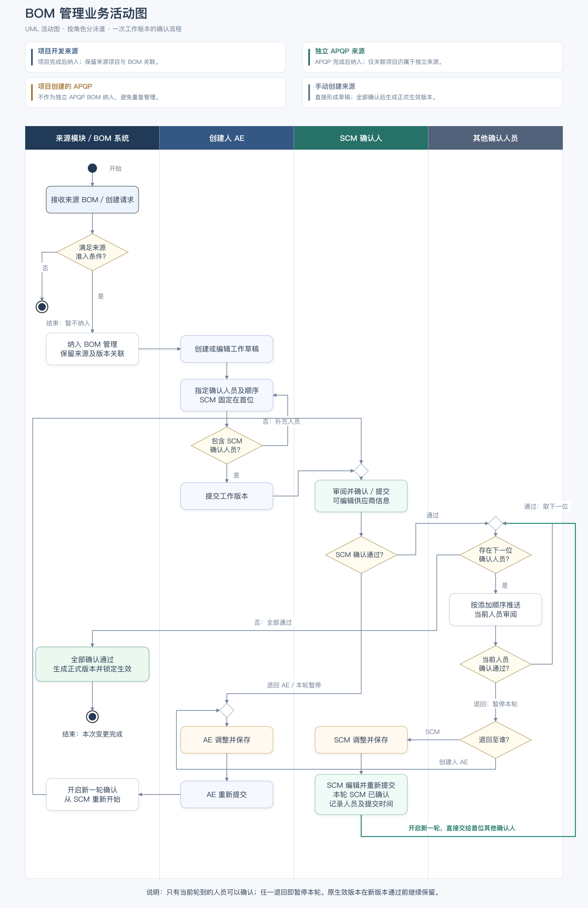
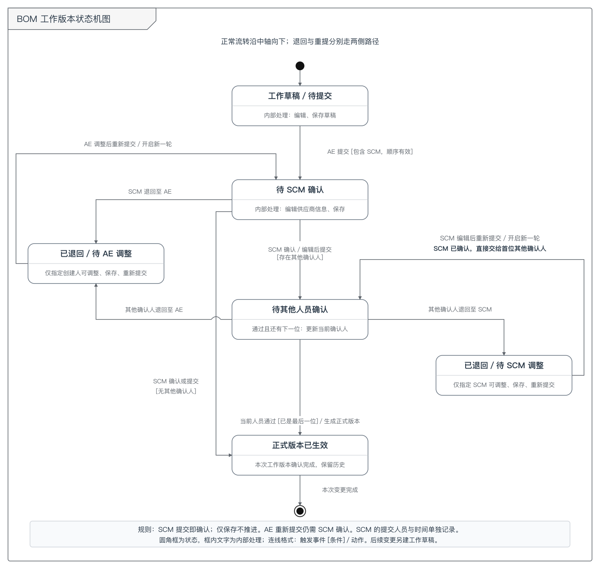

# BOM 管理业务描述、流程图与状态机图

日期：2026-10-27  
性质：业务流程说明，依据本次用户描述与已确认的顺序确认规则整理；不代表页面已实现或验收，不作为完整 PRD。

## 一、业务描述

BOM 管理承接已完成项目及已完成独立 APQP 的 BOM，也支持 AE 在模块内手动创建 BOM。进入模块后，可维护 BOM 结构、零件信息及供应商相关信息，通过顺序确认生成正式生效版本，并保留来源、版本和每轮操作记录。

### 1. 数据来源与进入节点

| 数据来源 | 进入 BOM 管理的条件 | 归属与处理 |
| --- | --- | --- |
| 项目开发创建的 BOM | 来源项目已完成 | 进入“项目开发”页签，保留来源项目、BOM 及 L1 版本关联 |
| 独立 APQP 创建的 BOM | 来源 APQP 自身已完成 | 进入“零件 APQP”页签，保留来源 APQP 与 BOM 关联 |
| 通过项目创建的 APQP 中的 BOM | 无论该 APQP 是否完成 | 不作为独立 APQP BOM 进入“零件 APQP”页签，避免与项目来源重复管理 |
| 在 BOM 管理中手动创建的 BOM | AE 创建并保存 | 直接进入本模块，不要求先完成某个来源项目或来源 APQP；按选择的归属类型展示 |

APQP 是否属于项目创建，应根据实际创建来源判断。独立创建后仅关联了项目的 APQP，仍按独立 APQP 处理，不能仅凭“所属项目不为空”排除。创建来源缺失时应先核实，不能自动当作独立 APQP 导入。

来源项目或独立 APQP 未完成时，其 BOM 继续在来源模块管理，不提前进入本模块。来源完成事件重复触发不得重复创建 BOM 记录；进入本模块本身不产生新业务版本。来源已有版本及确认状态应延续，不因进入本模块自动认定为生效。

### 2. 编辑、提交与确认

1. AE 手动创建 BOM，或对符合准入条件的已有 BOM 发起编辑，形成工作草稿。已有正式生效版本继续保留。
2. AE 指定确认人员，必须包含 SCM 部门人员。SCM 确认节点固定在第一位；其他确认人员按添加顺序排列，清单明确展示顺序。
3. AE 提交后，工作草稿进入“待 SCM 确认”。此时仅 SCM 接收可处理的确认任务，后续人员等待前序确认。
4. SCM 可直接确认，也可编辑供应商相关信息后点击“保存并提交”；提交即完成 SCM 确认并流转至下一位，无需再次确认。仅保存修改不推进流程。
5. SCM 确认后，将确认任务推送至第一位其他确认人员；其确认后再推送给下一位，依次处理。多人属于同一部门或同一角色时，也必须按人员分别记录结果。
6. 任一人员退回，则本轮未通过并暂停，后续人员不能继续确认。退回必须填写原因，保留退回人、接收人、时间及当轮 BOM 快照。
7. 指定接收人调整后重新提交，开启新一轮确认。AE 重新提交后由 SCM 确认；SCM 调整后重新提交即完成本轮 SCM 确认，直接交给首位其他确认人。其他人员再次按原顺序确认，此前结果保留为历史。
8. 最后一位所需确认人员通过后，工作内容生成新的正式生效版本并锁定；原生效版本转为历史版本，保留追溯。若仅配置 SCM，则 SCM 确认通过即完成本轮。

### 3. 退回规则

| 当前操作人 | 可退回对象 | 后续处理 |
| --- | --- | --- |
| SCM 确认人 | 创建人 AE | AE 调整并重新提交，从 SCM 开始新一轮确认 |
| 其他确认人 | 创建人 AE 或 SCM，由退回人选择 | 仅指定接收人调整；AE 重提从 SCM 开始，SCM 重提即确认并交给下一位 |

采用顺序确认，同一时间仅一名确认人员拥有当前确认任务，因此不会发生两名人员同时分别退回给 AE 和 SCM 的冲突。退回后先暂停整轮，再由唯一接收人调整。

### 4. 版本与状态口径

- 本次描述采用“全部确认通过后生成新的正式生效版本”。首次正式生效可为 V1；当前生效为 V1 时，修改内容全部通过后生成 V2。
- 草稿保存、AE 提交、SCM 编辑、人员确认、退回及重新提交，都不单独生成新的正式版本。确认过程中使用工作记录和轮次标识进行追溯。
- “版本号”与“确认轮次”分开：同一工作内容可以经历多轮提交、确认和退回，最终只形成一个新的正式生效版本。
- 编辑中的工作内容与当前生效版本分开维护；待确认或退回不改变原生效版本。
- 项目下各 L1 BOM 继续维护独立版本链，不因某一 L1 修改而让其他 L1 同步升版。
- 列表待确认状态统一展示“待确认”，当前节点、人员顺序及各轮结果在“确认记录”中查看；AE 提交环节使用“待提交 / 已提交”。

**与现有 Demo 的差异：**此前已实现的是首次提交分配 V1、全部通过后锁定生效；本次业务描述调整为全部通过后生成正式生效版本。本文件说明目标业务规则，本次未修改 HTML 的版本生成逻辑。

## 二、UML 业务活动图（泳道）

按来源／系统、创建人 AE、SCM 确认人和其他确认人员划分泳道。黑色实心圆表示开始，靶心表示结束；圆角矩形表示活动，菱形表示判断或替代路径的合并。判断分支标明处理条件，退回后暂停本轮；AE 重提从 SCM 开始，SCM 重提直接进入其他人员确认。

[下载 SVG 矢量图](../流程图/BOM管理_UML业务活动图_美化版.svg) · [下载 draw.io 可编辑文件](../流程图/BOM管理_UML业务活动图_美化版.drawio)

## 三、UML 工作版本状态机图

参考用户截图采用白底灰线、圆角状态框、黑色初始节点及靶心终止节点。正常流转沿中轴向下，AE 与 SCM 退回状态分置左右两侧，重新提交使用外侧回路；保存及逐人确认以框内内部处理说明表达，减少自循环箭头。唯一交叉采用跨线桥区分，不表示汇合。

[下载 SVG 矢量图](../流程图/BOM管理_UML状态机图.svg)

本图描述一次工作内容的处理过程：正式版本生效后结束本次处理；后续变更另建工作草稿，已生效版本继续保留。SCM 调整后重新提交是单独的迁移动作，记录实际提交时间，并完成 SCM 确认，直接流转至首位其他确认人员；该路径不再进入“待 SCM 确认”。AE 调整后重新提交仍返回“待 SCM 确认”。

## 四、关键数据及追溯

| 数据 | 用途 |
| --- | --- |
| BOM 标识、L1 总成标识 | 维护独立 BOM 与版本链边界 |
| 创建来源、来源对象标识、来源 BOM／版本标识 | 区分项目、独立 APQP、手动创建，避免重复导入 |
| APQP 实际创建来源 | 排除通过项目创建的 APQP BOM |
| 来源完成状态与完成时间 | 判断进入 BOM 管理的节点 |
| 创建人、创建时间 | 记录 BOM 首次创建信息，不随确认或后续编辑变化 |
| 当前生效版本、工作记录、确认轮次 | 区分正式版本与在途修改 |
| 确认人员标识、部门、确认顺序、当前节点 | SCM 优先、逐人顺序流转及任务权限 |
| 退回接收人、原因、操作时间及当轮快照 | 确定唯一调整人并保留跨轮追溯 |
| 提交、编辑、确认、退回、重新提交和生效记录 | 支撑确认记录及完整业务审计 |
